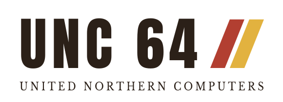

<p align="center">
  <picture>
    <source media="(prefers-color-scheme: dark)" srcset="assets/unc-logo-dark.svg">
    
  </picture>
</p>

<p align="center"><b>A computer that fits in your head.</b></p>

The UNC 64, by United Northern Computers, is an 8-bit home computer from the mid-1980s that never existed. This is the machine, emulated for real: a cycle-counted 6502-family processor, a system ROM with UNC BASIC, a character set, a beeper and a three-voice sound chip, tape, and a video board with sprites and smooth scrolling. 64K of memory. One manual. You can know all of it.

## Start in one minute: the Machine Room

The Machine Room is the UNC 64 in a web page: an editor, the real emulator, a debugger and a tape deck, with example programs and games to open, run and change. Nothing to install.

- **In your browser:** **[unc64.github.io/unc64](https://unc64.github.io/unc64/)**
- **Offline, one file:** `scripts/build-machine-room.sh` (Node, nothing to install) writes `build/machine-room/index.html`. Double-click it: it runs from your disk, without the internet. Releases will carry it as `machine-room.html`.
- **From a clone**, with nothing but Python:

  ```sh
  git clone https://github.com/unc64/unc64 && cd unc64
  python3 -m http.server -d web 8064     # then open http://localhost:8064
  ```

It opens on HELLO. Press **Run** (Ctrl+Enter):

```asm
; Print a string through the ROM, then halt.
PRSTR   = $FF09

        .org $0800
start:  LDX #<msg
        LDY #>msg
        JSR PRSTR
        HLT

msg:    .text "HELLO FROM THE UNC 64!"
        .byte 13, 0
```

Change the message, run it again. Then:

- **Browse** opens the examples: small programs (raster bars, a custom character set, a tune, the keyboard) and games with their full source: SNAKE, STACK, ORBIT, DEBUG, and AURORA for the video board. CLOUDBERRY, a scrolling platformer, FELLRIDER, a moped with real suspension, and FROSTHALL, a raycaster at 1 MHz, are for the NIECE: a prototype graphics chip that isn't part of the machine proper (manual chapter 17). MUSIC TRACKER is there too, an editor for the sound chip written in assembly.
- **Hover** over any instruction, register or ROM call in the editor for what it does and how many cycles it takes. **Help** explains the Machine Room; the whole machine is in [the manual](docs/prg/programmers-reference-guide.md).
- **The debugger**: breakpoints, stepping (F7, F6 over), run and stop (F8), registers and memory.
- **Save** puts your program on a cassette: a `.unc.png`, a picture of a tape with the program inside, to share or to load in the game.
- Or write BASIC: **New**, then **BASIC**, `10 PRINT "HELLO"`, Run.

## Learn the machine

[The Programmer's Reference Guide](docs/prg/programmers-reference-guide.md) is the whole machine in one book: the processor, the screen, timing and the raster, interrupts, the keyboard, sound, the ROM, tape, UNC BASIC, the video board, every instruction with its cycles. It's also the spec: every program listing in it is assembled and run by the tests. Coming from the 6502? Start at Appendix F.

AI agents: [`llms.txt`](llms.txt) and [`llms-full.txt`](llms-full.txt).

## Your own editor

Prefer Vim, Neovim or VS Code? The assembler and the language server (diagnostics, completion, hover, cycle counts inline) install with Rust:

```sh
cargo install --git https://github.com/unc64/unc64 unc-asm unc-lsp
unc-asm hello.s --tape hello.tap --name HELLO   # a tape the Machine Room and the game load
```

Editor setup: [`editors/`](editors/README.md).

## Hacking on the machine

The emulator, the assembler and the ROM are Rust and UNC assembly, in one workspace:

| | |
|---|---|
| `crates/unc-core` | The machine. Zero dependencies, deterministic, cycle-counted. |
| `crates/unc-asm` | Assembler, disassembler, tape and BASIC tools |
| `crates/unc-wasm` | The machine for the browser, a plain C ABI |
| `crates/unc-lsp` | The language server |
| `rom/` | The system ROM and UNC BASIC, in UNC assembly, and the character set |
| `docs/prg/`, `docs/cassettes.md` | The manual and the cassette format |
| `web/` | The Machine Room |
| `games/`, `web/samples/` | The examples, all tested |
| `editors/`, `fonts/`, `scripts/` | Editor support, the UNC font and the manual's fonts, the build scripts |

```sh
cargo test --workspace                 # the machine, the assembler, every listing in the manual
scripts/build-web.sh                   # the ROM and the browser build, after changing the core or rom/system.s
scripts/build-machine-room.sh          # the Machine Room as one file: build/machine-room/index.html
node scripts/check-machine-room.mjs    # and a check of it in a real browser
```

[`AGENTS.md`](AGENTS.md) has the rules of the road. Issues and pull requests are welcome, and so are corrections from anyone who wrote 6502 code for real.

## Rev A (alpha)

The machine is **System Rev A**, and Rev A is in alpha: not frozen yet. Until it is, anything in it can still change, and a program may need changing with it. Once it's frozen, a program that runs on a Rev A machine runs the same, cycle for cycle, on every later one. [`REVISIONS.md`](REVISIONS.md) says what that will cover.

## The game

UNC 64 is also a game: you, a modern-day software engineer, inherit your uncle's old computer, switch it on, and wake up in 1984 at the same desk. It's at [unc64.com](https://unc64.com). This repository is the machine, free to use and change; the game, the story around it, is sold separately.

## Licence

MIT OR Apache-2.0, at your option, as Rust projects do: the code, the ROM, UNC BASIC and the manual. Fonts keep their own licences, beside them.

## Why

An engineer's exploration of the 6502 era, out of admiration for the people who programmed these machines for real. As a kid I typed BASIC listings out of library books on my uncle's old Amiga; he'd had a C64 before it. I didn't meet 6502 assembly until university, much later. The UNC 64 is the machine I'd have wanted on that desk.

Much of the code is written with AI assistance; the machine's design and the manual are where the evenings go. If you wrote this kind of code in the eighties, you know more about it than I do: corrections are welcome. — [Viljami Kuosmanen](https://viljami.io)
